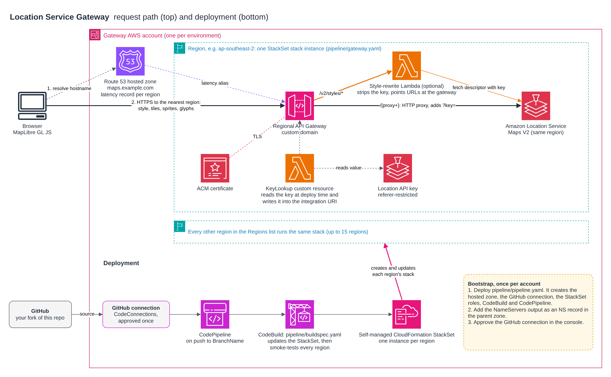

# Location Service Gateway

Serve Amazon Location Service Maps V2 from one custom domain in many AWS regions. Each region gets a referer-restricted Location API key and a regional API Gateway that proxies to Amazon Location in that region and adds the key on the way. Route 53 latency routing sends each user to the nearest region. An optional Lambda keeps the key out of the browser entirely. Maps V2 needs no map resource, so none is created.

There are two ways to deploy it:
- `deploy.sh` deploys region by region from your machine. It's the quick way to try it out.
- `pipeline/` is the managed way: a CodePipeline that deploys the gateway to every region as a CloudFormation StackSet and smoke-tests each one. See [Deploying from a pipeline](#deploying-from-a-pipeline-stackset).

## Overview

Building on the experience from developing [findyourfivepm.com](https://findyourfivepm.com), this script solves a crucial challenge: ensuring low-latency, high-quality, and cost-effective map tile delivery worldwide. Amazon Location Service (ALS) was chosen for its robust features but required an innovative approach to overcome regional latency when serving map tiles. 

For an in-depth exploration of this project's conception, challenges, and the decision-making process, see my detailed blog post: [Regional to Global - Adapting Amazon Location Service for Worldwide Use](https://www.123cloud.st/p/regional-to-global-adapting-amazon).

### Prerequisites

Before running this script, ensure that you have executed `aws configure` to set up your CLI with access keys, secret keys, and default region information. Please use a profile that has permissions to create resources specified in the script. My preference is to use AWS SSO to manage multiple accounts and roles. 

IMPORTANT: ensure that you are in the right AWS account before running the script. You can verify this by running the following command:

```bash
aws sts get-caller-identity --profile <your-profile>
```

The profile also needs `geo-maps:GetTile` and `geo-maps:GetStaticMap`. Amazon Location refuses to create an API key for a caller that doesn't itself hold every action the key allows. An administrator profile already has them.

You will need a domain name and a Hosted Zone ID for the domain to serve the API from. The domain name should be a registered domain, and the Hosted Zone ID should be available in the AWS Route 53 service. You can use a domain registered with AWS Route 53 or a domain registered with another registrar as long as the Hosted Zone ID is available in AWS Route 53.

## Configuration

Customize the following variables in the script as per your requirements:

- `DOMAIN_NAME`: The domain name to serve the GEO API from. (Note: This domain should be registered and available in AWS Route 53.)
- `CORS_ORIGIN`: Your frontend origin including the scheme, for example `https://example.com`. (For testing you can set this to "*".)
- `ALLOWED_REFERERS`: Comma-separated Referer patterns the Location API key accepts, for example `https://example.com/*`. This is what stops other sites using your key.
- `HostedZoneId`: The Hosted Zone ID of your domain. 
- `DEPLOY_REGIONS`: A space-separated list of regions where you wish to deploy the services. They must support Amazon Location Service Maps V2; deploy.sh lists the supported regions. 

Every setting can also be passed as an environment variable of the same name.

## Usage

To deploy the services, simply run the script and provide the AWS CLI profile you wish to use when prompted:

```bash
./deploy.sh
```

When done cleaning up, you can remove the deployed stacks and DNS records. Run the script with the `--remove` flag and provide the AWS CLI profile when prompted:
```bash
./deploy.sh --remove
```

## CloudFormation Templates

The script utilizes `geo-api.yaml` and `geo-services.yaml` CloudFormation templates:

- `geo-api.yaml`: Creates a regional API Gateway on your custom domain that proxies requests to the Amazon Location Service Maps V2 endpoint in that region, adding the API key and CORS settings.
- `geo-services.yaml`: Creates a Maps V2 API key (`LocationServiceGatewayKey-<region>`) limited to your referers. Maps V2 needs no map resource.

## Using it from a map

Point MapLibre GL JS at the gateway's style descriptor:

```js
new maplibregl.Map({
  container: 'map',
  style: 'https://geo.example.com/v2/styles/Standard/descriptor', // also Monochrome, Hybrid, Satellite; add ?color-scheme=Dark
});
```

Note: the style descriptor returned by Amazon Location points tiles, sprites and glyphs straight at `maps.geo.<region>.amazonaws.com`, with the API key in the tile URL. The descriptor comes from the region nearest the user, so tiles do too, but the key is visible in the browser. The referer restriction on the key is what protects it.

### Hiding the key (optional)

Set `HIDE_API_KEY=true` when you run `deploy.sh`. A small Lambda then serves `/v2/styles/*`: it fetches the descriptor with the key, rewrites the tile, sprite and glyph URLs to your gateway domain and removes the key. The gateway adds the key back on the way to Amazon Location, so the key never reaches the browser. The browser's Referer is still forwarded, so the key's referer restriction keeps working.

The cost of this: every tile now goes through API Gateway, so you pay API Gateway request charges on top of Amazon Location's, and the style request runs through a Lambda.

### Serving several sites from one gateway

List every site in `ALLOWED_REFERERS` (for example `https://site-a.com/*,https://site-b.com/*`) and set `CORS_ORIGIN='*'`. Amazon Location already answers tile requests with `Access-Control-Allow-Origin: *`, so the referer list on the key is what limits use to your sites.


## Deploying from a pipeline (StackSet)

`deploy.sh` is the quick manual path. For a managed environment, use the templates in `pipeline/` instead, so the whole deployment is defined in CloudFormation:

- `pipeline/gateway.yaml` is the per-region stack: the API key, a custom resource that reads the key's value (so it never appears as a stack parameter), the regional API Gateway, its certificate, its latency-routing record and the optional key-hiding Lambda.
- `pipeline/pipeline.yaml` is deployed once per environment account. It creates the gateway's hosted zone, a GitHub connection, the self-managed StackSet roles and a CodePipeline. Each push to `BranchName` runs `pipeline/buildspec.yaml`.
- `pipeline/buildspec.yaml` creates or updates the StackSet, adds any missing regions, and then smoke-tests every region. Each region must return 200 for the style descriptor and a tile with an allowed Referer, 403 for a tile with no Referer, and no `key=` in the descriptor when the key is hidden.

Use one AWS account per environment, for example a staging account and a production account.

### Before you start

1. **Fork this repo.** The pipeline reads from GitHub through a connection that you approve for your own account, so it can't read someone else's repository. Pass your fork as `RepositoryId` (the default is this repo).
2. **Enable opt-in regions.** ap-southeast-5 and eu-south-2 are in the default `Regions` list but are opt-in regions. Either enable them in the account first (AWS Account > Regions) or leave them out of `Regions`. Deploying to a region that isn't enabled fails.
3. **Pick a hostname you can delegate.** The pipeline stack creates a hosted zone for `DomainName`, and you need to be able to add an NS record for it in the parent zone.

The StackSet execution role in `pipeline.yaml` already has the less obvious permissions: the `geo-maps` actions the API key allows (needed to create the key), and `iam:CreateServiceLinkedRole` for API Gateway's role. A new account doesn't have that role until its first custom domain is created.

### Parameters

| Parameter | Default | What it sets |
|---|---|---|
| `Environment` | (required) | `Staging` or `Production`. Used in resource names. |
| `RepositoryId` | `jeeshofone/LocationServiceGateway` | Your fork, as `owner/repo`. |
| `BranchName` | `staging` | The branch the pipeline deploys. Use `main` for production. |
| `DomainName` | (required) | The gateway hostname, for example `maps.example.com`. |
| `AllowedReferers` | (required) | Comma-separated Referer patterns for every site that uses the gateway. |
| `SmokeReferer` | (required) | One Referer that `AllowedReferers` accepts, used by the smoke test. |
| `Regions` | 15 Maps V2 regions | Space-separated regions to deploy to. |
| `CORSOrigin` | `*` | The CORS origin returned on preflight requests. |
| `HideApiKey` | `true` | Turns the key-hiding Lambda on or off. |

### Set up an environment

Deploy the pipeline stack once from your machine. Staging:

```bash
aws cloudformation deploy --template-file pipeline/pipeline.yaml --stack-name lsg-pipeline-staging \
  --capabilities CAPABILITY_NAMED_IAM --parameter-overrides Environment=Staging \
  RepositoryId=your-org/LocationServiceGateway BranchName=staging \
  DomainName=maps.staging.example.com \
  AllowedReferers='https://staging.site-a.com/*,https://staging.site-b.com/*' \
  SmokeReferer=https://staging.site-a.com/
```

Production, in its own account:

```bash
aws cloudformation deploy --template-file pipeline/pipeline.yaml --stack-name lsg-pipeline-production \
  --capabilities CAPABILITY_NAMED_IAM --parameter-overrides Environment=Production \
  RepositoryId=your-org/LocationServiceGateway BranchName=main \
  DomainName=maps.example.com \
  AllowedReferers='https://site-a.com/*,https://site-b.com/*' \
  SmokeReferer=https://site-a.com/
```

Then do the following once per account:
1. Add the `NameServers` output as an NS record for `DomainName` in the parent zone. Do this before the first pipeline run, because the certificates validate through that zone.
2. Complete the GitHub handshake for the `ConnectionArn` output (Developer Tools > Settings > Connections > Update pending connection).
3. Release the pipeline, or push to the branch.

After that, every push to `BranchName` redeploys the StackSet and runs the smoke test. A change to `pipeline/pipeline.yaml` itself is not applied by the pipeline: redeploy that stack with the same command.

## AWS terms and map attribution

Amazon Location's map data comes from third-party providers, and Section 82 of the [AWS Service Terms](https://aws.amazon.com/service-terms/) sets rules for using it. The ones that matter most for a gateway like this:

- **No caching.** You may not store or cache map tiles or other Location data, apart from a few narrow exceptions for route and geocoding results. Don't put a caching layer such as CloudFront in front of the gateway. This gateway passes every request through to Amazon Location.
- **No resale as a map service.** You may not use Location data to offer a product similar to the map providers' own services unless it adds substantial value of its own. Serving maps inside your own sites is fine. Selling access to the gateway itself is not.
- **Keep the attribution.** You must pass through the data attribution and not hide or modify it. MapLibre shows the style's attribution in the corner of the map by default, so leave that control on. AWS also asks you to link to its [data attribution page](https://docs.aws.amazon.com/location/latest/developerguide/data-attribution.html) from your end-user terms.
- **No branding on the map.** You may not put your company name or ads on the map display itself.

This is a summary, not legal advice. Read Section 82 for the full terms before you deploy.

## Architecture Diagram



The source is `diagram.drawio`. Open it in [diagrams.net](https://app.diagrams.net/) or the draw.io desktop app to edit it, then export it over `diagram.png`.

Ensure you have the necessary permissions and meet all prerequisites before running the script or deploying the CloudFormation templates.
